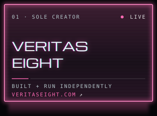
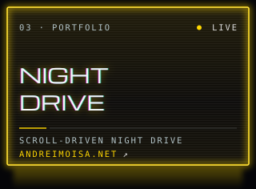
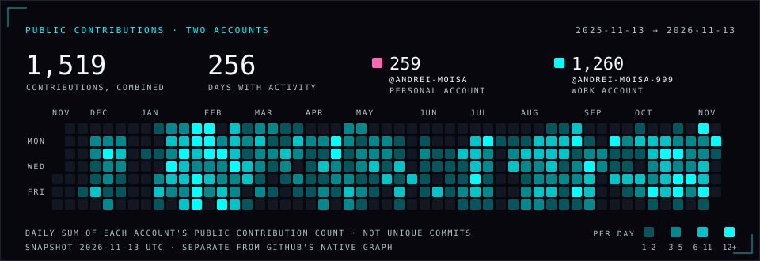

I build complete products, from interface to infrastructure, and the harnesses that make AI dependable: agent orchestration, MCP, evaluation and recovery. Lately that includes connecting web tools to Unreal Engine for 3D production.

This is my personal account. Work contributions land on [@Andrei-Moisa-999](https://github.com/Andrei-Moisa-999), in repositories that aren't public, so only their counts show.

**[andreimoisa.net](https://andreimoisa.net)** · [LinkedIn](https://linkedin.com/in/andreimoisa) · [Work account](https://github.com/Andrei-Moisa-999)

### 01 · Now

**Full-stack developer · Zero One Creative** · Nov 2025 to present 
At this London AI creative-tech studio I build the systems around AMARA: the web platform, AI agents and Unreal integration that turn generated assets into usable scenes and production workflows. Recent work includes MCP access for external agents and reconnectable sessions.

Before that: contract work at Bramforth.ai (2025). BSc Computer Science with AI, Brunel University (2023).

### 02 · Shipped

- **[Veritas Eight](https://veritaseight.com)**: an AI workspace for network marketers that I built and run on my own. Streaming multi-model chat, a memory layer for each prospect, retrieval over product catalogues, Stripe billing, English and Romanian.
- **[Taurus Intelligence](https://taurusintelligence.com) · Past work, over 18 months ago.** I contributed to application architecture and AI integration for this AI sales-strategy platform.
- **[andreimoisa.net](https://andreimoisa.net)**: my portfolio, a night drive through a generated neon city with a stop for each part of the work.

All three are live. Their code isn't published on this account.

### 03 · Stack

**Product** &nbsp;TypeScript · Nuxt / Vue · React / Next.js · Node.js · Python 
**Data** &nbsp;Supabase · PostgreSQL · pgvector · Redis 
**AI systems** &nbsp;Agent orchestration · MCP · evaluation · semantic search 
**3D** &nbsp;Unreal Engine · Three.js · spatial validation · asset pipelines 
**Platform** &nbsp;Cloudflare · Vercel · AWS · Docker · Stripe

### 04 · Activity

<!-- activity:start (generated by tools/build_activity.py; do not edit by hand) -->

Daily contribution counts from the public calendars of <a href="https://github.com/Andrei-Moisa">@Andrei-Moisa</a> (personal) and <a href="https://github.com/Andrei-Moisa-999">@Andrei-Moisa-999</a> (work), combined into one square per day. GitHub counts commits, pull requests, issues and reviews, and shows private work only as anonymized counts. Snapshot taken 2026-11-12. GitHub&#39;s native graph further down this page covers this account only.

Monthly totals

| Month | @Andrei-Moisa | @Andrei-Moisa-999 | Combined |
| :-- | --: | --: | --: |
| Nov 2025 (12–30) | 0 | 2 | 2 |
| Dec 2025 | 0 | 76 | 76 |
| Jan 2026 | 2 | 202 | 204 |
| Feb 2026 | 40 | 162 | 202 |
| Mar 2026 | 7 | 63 | 70 |
| Apr 2026 | 14 | 92 | 106 |
| May 2026 | 7 | 65 | 72 |
| Jun 2026 | 1 | 55 | 56 |
| Jul 2026 | 1 | 90 | 91 |
| Aug 2026 | 4 | 155 | 159 |
| Sep 2026 | 62 | 62 | 124 |
| Oct 2026 | 82 | 155 | 237 |
| Nov 2026 (1–12) | 39 | 81 | 120 |
| **Total** | **259** | **1,260** | **1,519** |

<!-- activity:end -->
